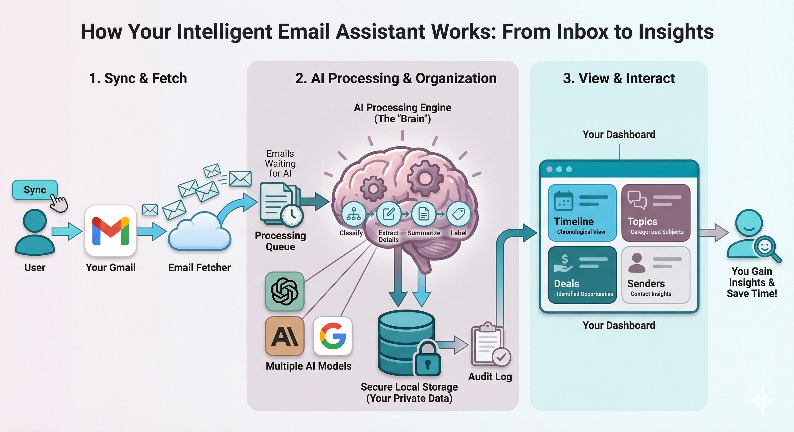
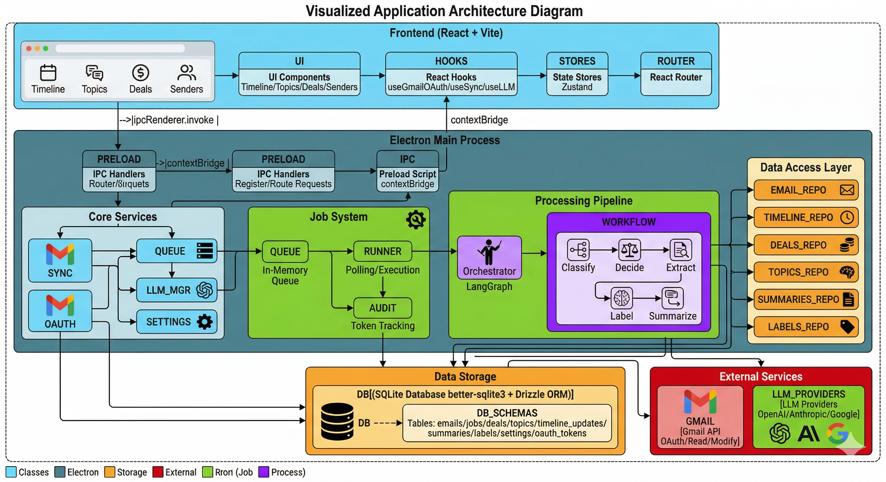

# TuskerBrain 🧠

**Local-first Gmail inbox management with AI-powered insights**

Transform your chaotic Gmail inbox into an organized, actionable dashboard. TuskerBrain is an intelligent email assistant that automatically classifies, extracts, and summarizes your emails—giving you back control over your digital life.



## ✨ What TuskerBrain Does

TuskerBrain connects to your Gmail account and acts as an intelligent layer on top of your inbox—automatically organizing, summarizing, and extracting what matters while keeping everything private on your machine.

### 🎯 Three-Step Process

1. **Sync & Fetch** - Securely connects to your Gmail via OAuth, fetching emails from a configurable lookback period (7 to 90 days)
2. **AI Processing & Organization** - Uses advanced AI models to classify emails, extract deals, identify action items, and organize by topics
3. **View & Interact** - Presents everything in a beautiful dashboard with Timeline, Topics, Deals, and Senders views

### 🔒 Privacy-First Design

- **100% Local Storage** - All your data stays on your machine in a local SQLite database
- **Your Own API Keys** - Use your own LLM API keys (OpenAI, Anthropic, or Google)—no shared infrastructure
- **No Cloud Sync** - Nothing is uploaded to TuskerBrain servers (because there aren't any!)
- **Transparent Audit Log** - Track every AI operation and token usage with complete traceability

---

## 📋 Features

### Intelligent Email Management

#### Automatic Classification
TuskerBrain analyzes each email and categorizes it into one of four types:
- **Regular** - Personal and work emails that need attention
- **Updates** - Transactional emails, statements, notifications
- **Social** - Social media notifications and networking updates
- **Promotional** - Marketing emails, deals, and offers

#### Smart Archival & Cleanup
Based on email type and age, TuskerBrain automatically applies cleanup rules:

| Email Type | < 1 Month | 1-6 Months | > 6 Months | > 2 Years |
|------------|-----------|------------|------------|-----------|
| Regular | Process with AI | Process with AI | Archive | Archive |
| Updates | Process with AI | Archive | Archive | Archive |
| Social | Process with AI | Delete | Delete | Archive |
| Promotional | Extract Deals | Delete | Delete | Archive |

This keeps your inbox clean without manual intervention while ensuring important emails get processed with AI.

#### Incremental Sync
After the initial sync, TuskerBrain runs periodic incremental syncs (configurable: 15 min, 30 min, 1 hr, 2 hr, or daily) to fetch only new or changed emails since the last sync—minimizing API usage and processing time.

---

### Timeline View

A chronological feed of processed emails transformed into actionable updates:

- **Priority Levels** - High, medium, and low priority indicators help you focus on what matters
- **Action Items** - Automatically detected tasks with due dates extracted from email content
- **Financial Impact** - Payment amounts, invoice totals, and financial deadlines highlighted
- **Sentiment Analysis** - Understand the tone of each email (positive, negative, neutral)
- **Urgency Detection** - Time-sensitive emails flagged for immediate attention
- **Follow-up Dates** - Deadlines and meeting dates automatically extracted and displayed
- **Key Entities** - Important dates, amounts, and names identified and highlighted

**Filtering Options:**
- Filter by email type (Regular, Updates, Social, Deals)
- Filter by topic (e.g., Banking/Chase, Shopping/Amazon)
- Filter by sender domain
- Filter by priority level
- Filter by date range
- Combine multiple filters with AND logic

---

### Topic Organization

#### Hierarchical Topic Structure
Emails are automatically organized into a hierarchical topic system:

```
Banking
├── Chase
├── HSBC
└── Credit Cards

Shopping
├── Amazon
├── eBay
└── Online Orders

Projects
├── Client-ABC
└── Personal-Website

Travel
├── Airlines
└── Hotels
```

#### Predefined Parent Categories
TuskerBrain recognizes common email categories out of the box:
- **Banking** - Banks, credit cards, financial institutions
- **Education** - Online courses, certifications, universities
- **Projects** - Client work, personal projects
- **Shopping** - E-commerce, online orders, retail
- **Travel** - Flights, hotels, bookings
- **Health** - Medical, insurance, fitness
- **Personal** - Family, friends, personal matters
- **Business** - Work, clients, professional
- **Technology** - Development tools, subscriptions
- **Entertainment** - Streaming, gaming, events

#### Topic Summaries
Each topic has a rolling summary that evolves with new emails:
- 3-4 paragraphs, max 500 words
- First paragraph provides high-level context
- Older information gradually receives less focus
- Updated automatically with each new email in the topic
- Tracks update count and last modified date

---

### Sender Insights

#### Sender Summaries
Get a concise summary for each unique sender domain:
- What type of emails you typically receive from them
- Common topics and themes
- Email frequency and recency
- Running summary that updates with new emails

#### Sender Categories
Senders are automatically categorized based on their content:
- Financial institutions
- E-commerce platforms
- Social networks
- Service providers
- Personal contacts

---

### Deal Extraction

From promotional emails, TuskerBrain extracts:

- **Deal Title & Description** - Clear summary of the offer
- **Brand Name** - Automatically identified from sender or content
- **Promo Codes** - Discount codes extracted and highlighted
- **Deal Value** - Percentage or fixed amount discounts
- **Expiry Dates** - Time-limited offers clearly marked
- **Minimum Purchase** - Spending requirements noted
- **Deal Links** - Direct links to the offer
- **Category** - Electronics, clothing, travel, etc.

#### Deal Management
- **Active/Expired Status** - Clear visual indicators
- **Mark as Used** - Track which deals you've redeemed
- **Dismiss Deals** - Hide irrelevant offers
- **Expiry Notifications** - See which deals are expiring soon

---

### Gmail Label Integration

TuskerBrain creates and manages Gmail labels to keep your inbox organized:

```
TuskerBrain/
├── Processed              # Marks email as processed
├── Topic/
│   ├── Banking/
│   │   ├── Chase
│   │   └── HSBC
│   └── Shopping/
│       └── Amazon
└── Sender/
    └── chase.com
```

**Benefits:**
- Filter emails by topic directly in Gmail
- See which emails have been processed
- Group emails by sender domain
- Labels sync bidirectionally between TuskerBrain and Gmail

---

### Sync & Processing Control

#### Initial Sync Strategy
**Phase 1: Clean First (No AI)**
- Applies archival/deletion rules to all emails immediately
- Fast operation with no API costs
- Inbox cleaned up quickly

**Phase 2: AI Processing (Gradual Backfill)**
- Configurable lookback period (7, 14, 30, 60, or 90 days)
- Processes one day at a time
- Real-time progress: "Processing day 15 of 30..."
- Can be paused and resumed

#### Processing Controls
- **Pause/Resume** - Temporarily halt processing
- **Job Queue** - See pending, running, and completed jobs
- **Retry Logic** - Failed jobs automatically retry with exponential backoff
- **Progress Tracking** - Real-time status updates

---

### Settings & Preferences

#### Sync Configuration
- **Lookback Period** - Choose how far back to sync (7-90 days)
- **Sync Interval** - Set incremental sync frequency (15 min to daily)

#### LLM Provider Management
- **Multiple Providers** - Support for OpenAI, Anthropic, and Google AI
- **Provider Switching** - Change providers at any time
- **API Key Validation** - Keys tested before saving
- **Encrypted Storage** - Keys stored using Electron's safeStorage API

#### Processing Preferences
- Default email handling rules
- Topic naming conventions
- Label management options

## 📊 The Dashboard

Once processed, your emails are presented in four organized views (detailed feature descriptions above):

| View | Purpose | Key Information |
|------|---------|-----------------|
| **Timeline** | Chronological feed of important updates | Priorities, action items, financial impacts, deadlines |
| **Topics** | Hierarchical email categories | Topic summaries, email counts, sender breakdowns |
| **Deals** | Extracted promotional offers | Promo codes, expiry dates, brand names, deal values |
| **Senders** | Per-sender insights | Sender summaries, email frequency, content themes |

## 🏗️ Architecture

TuskerBrain is built as an Electron desktop application with a modern, modular architecture:



### Architecture Layers

#### **Frontend (React + Vite)**
- **UI Components** - Reusable React components for Timeline, Topics, Deals, and Senders views
- **React Hooks** - Custom hooks (`useGmailOAuth`, `useSync`, `useLLM`) for IPC communication
- **State Management** - Zustand stores for local state
- **Routing** - Hash-based navigation between views

#### **Electron Main Process**
- **IPC Layer** - Secure contextBridge for renderer-to-main communication
- **Core Services**:
  - `GmailSyncManager` - Handles Gmail API sync operations
  - `GmailOAuthService` - Manages OAuth 2.0 authentication flow
  - `LLMProviderManager` - Multi-provider LLM abstraction
  - `SettingsManager` - Application configuration

#### **Job System**
- **JobQueue** - In-memory queue with deduplication and retry logic
- **JobRunner** - Polling executor with configurable concurrency
- **AuditLogger** - Tracks token usage and job execution history

#### **Processing Pipeline**
- **Orchestrator** - Coordinates the full email processing workflow
- **LangGraph Workflow** - State-machine based AI pipeline:
  1. **Classify** - Determine email type (regular/updates/social/promotional)
  2. **Decide** - Choose action (process/archive/delete/extract)
  3. **Extract** - Pull out deals, updates, or action items
  4. **Label** - Assign topic labels
  5. **Summarize** - Generate concise summaries

#### **Data Access Layer**
Repository pattern for all entities:
- `EmailRepository` - Email CRUD operations
- `TimelineRepository` - Timeline updates
- `DealsRepository` - Deal extraction and management
- `TopicsRepository` - Topic hierarchy and email linking
- `SummariesRepository` - Topic and sender summaries
- `LabelsRepository` - Gmail label management

#### **Data Storage**
- **SQLite Database** - Local persistent storage via `@libsql/client`
- **Drizzle ORM** - Type-safe database queries
- **Tables**: emails, jobs, deals, topics, timeline_updates, summaries, labels, settings, oauth_tokens, audit_log

#### **External Services**
- **Gmail API** - OAuth, read, and modify operations
- **LLM Providers** - OpenAI, Anthropic, and Google AI

## 🚀 Getting Started

### Prerequisites

- **Node.js** v20+ (use `nvm use` if you have nvm installed)
- **pnpm** package manager (`npm install -g pnpm`)
- **LLM API Key** - OpenAI, Anthropic, or Google AI

### Installation

```bash
# Clone the repository
git clone https://github.com/hashanw/tuskerbrain.git
cd tuskerbrain

# Install dependencies
pnpm install
```

### Development

```bash
# Start the development server with Electron
pnpm run electron:dev
```

This will:
1. Start Vite dev server on port 5173
2. Launch Electron with hot-reload enabled
3. Open DevTools for debugging

### Production Build

```bash
# Build for production
pnpm run electron:build

# Output will be in the 'release' directory
```

### Database Setup

```bash
# Generate database migrations
pnpm run db:generate

# Apply migrations to database
pnpm run db:push

# (Optional) Seed with sample data
pnpm run db:seed
```

## ⚙️ Configuration

### Environment Variables

Copy the example environment files and fill in your values:

```bash
cp .env.example .env
cp .env.llm.example .env.llm
```

| Variable | Description |
|----------|-------------|
| `GMAIL_CLIENT_ID` | Gmail OAuth client ID |
| `GMAIL_CLIENT_SECRET` | Gmail OAuth client secret |
| `GMAIL_REDIRECT_URI` | OAuth redirect URI (usually `http://localhost:3000`) |
| `OPENAI_API_KEY` | Your OpenAI API key |
| `ANTHROPIC_API_KEY` | Your Anthropic API key |
| `GOOGLE_API_KEY` | Your Google AI API key |

### LLM Provider Setup

During onboarding, you'll be prompted to:

1. **Connect Gmail** - OAuth flow to authorize TuskerBrain
2. **Set Preferences** - Choose lookback period (default: 30 days)
3. **Configure LLM** - Select provider and enter API key
4. **Start Processing** - Begin the initial sync and AI processing

## 🛠️ Tech Stack

| Category | Technology |
|----------|-----------|
| **Framework** | Electron 40, React 19, Vite 7 |
| **Language** | TypeScript 5 |
| **State** | Zustand, TanStack Query |
| **Database** | SQLite (@libsql/client), Drizzle ORM |
| **AI/LLM** | LangGraph, Vercel AI SDK, @ai-sdk/* |
| **Styling** | Tailwind CSS 4, Radix UI |
| **Testing** | Vitest, Playwright |
| **Build** | electron-builder |

## 📦 Available Scripts

```bash
# Development
pnpm run dev              # Start Vite dev server (renderer only)
pnpm run electron:dev     # Start full Electron app with hot-reload

# Build
pnpm run build            # Build renderer
pnpm run electron:build   # Build production Electron app

# Database
pnpm run db:generate      # Generate Drizzle migrations
pnpm run db:push          # Apply migrations
pnpm run db:seed          # Seed database with sample data

# Code Quality
pnpm run lint             # ESLint
pnpm run format           # Prettier
pnpm run test             # Vitest unit tests
pnpm run test:e2e         # Playwright E2E tests
```

## 🗂️ Project Structure

```
tuskerbrain/
├── src/                    # React frontend
│   ├── components/         # UI components and screens
│   ├── hooks/              # React hooks (IPC wrappers)
│   ├── stores/             # Zustand state stores
│   ├── config/             # Frontend configuration
│   └── types/              # TypeScript types
├── core/                   # Core business logic
│   ├── auth/               # Authentication utilities
│   ├── gmail/              # Gmail API client and sync
│   ├── jobs/               # Job queue and runner
│   ├── labeling/           # Topic labeling logic
│   ├── llm/                # LLM provider management
│   ├── processing/         # Email processing utilities
│   ├── repositories/       # Data access layer
│   ├── security/           # Security utilities
│   ├── summaries/          # Summary generation
│   ├── timeline/           # Timeline extraction
│   ├── workflows/          # LangGraph workflows
│   └── orchestrator.ts     # Processing coordinator
├── electron/               # Electron main process
│   ├── ipc/                # IPC handlers
│   ├── utility/            # Utility modules
│   ├── main.ts             # Entry point
│   └── oauth-service.ts    # OAuth service
├── database/               # Database layer
│   ├── schema.ts           # Drizzle schema definitions
│   ├── migrations/         # Database migrations
│   └── seed.ts             # Seed data
└── docs/                   # Documentation
    ├── images/             # Diagrams and screenshots
    └── plans/              # Development plans
```

## 🔐 Security

- **OAuth 2.0** - Secure Gmail authentication with token refresh
- **Encrypted Storage** - Sensitive tokens stored securely
- **Context Isolation** - Electron contextBridge for secure IPC
- **No Remote Code** - All processing happens locally
- **Audit Logging** - Complete traceability of AI operations

## 🧪 Testing

```bash
# Run unit tests
pnpm run test

# Run E2E tests
pnpm run test:e2e

# Run tests with coverage
pnpm run test --coverage
```

## 🤝 Contributing

Contributions are welcome! Please follow these steps:

1. Fork the repository
2. Create a feature branch (`git checkout -b feature/amazing-feature`)
3. Commit your changes (`git commit -m 'Add amazing feature'`)
4. Push to the branch (`git push origin feature/amazing-feature`)
5. Open a Pull Request

### Development Guidelines

- **TypeScript** - All code must be typed
- **Testing** - Add tests for new features
- **Linting** - Ensure `pnpm run lint` passes
- **Formatting** - Code is auto-formatted with Prettier

## 📝 License

**Source Available - Personal Use Only**

TuskerBrain is licensed under the [Creative Commons Attribution-NonCommercial-NoDerivatives 4.0 International License](https://creativecommons.org/licenses/by-nc-nd/4.0/).

- ✅ **Personal Use**: You are free to use, download, and modify TuskerBrain for personal, non-commercial purposes.
- ❌ **No Commercial Use**: You may not use TuskerBrain for any commercial purpose, including but not limited to selling, licensing, or incorporating into a commercial product.
- ❌ **No Redistribution**: You may not redistribute TuskerBrain, with or without modifications, in any form (source or binary).
- ✅ **Share Alike**: If you build upon or adapt TuskerBrain for personal use, your modifications must also be licensed under the same CC BY-NC-ND 4.0 license.

See the [LICENSE](LICENSE) file for the full license text. For commercial licensing inquiries, please contact the author.

## 🙏 Acknowledgments

- **LangGraph** - For the excellent workflow orchestration library
- **Vercel AI SDK** - Unified interface for multiple LLM providers
- **Drizzle ORM** - Type-safe database operations
- **Electron** - Cross-platform desktop app framework

## 📬 Support

For issues, questions, or feature requests, please open an issue on the [GitHub repository](https://github.com/hashanw/tuskerbrain/issues).

---

**Built with ❤️ by hashangit**

*Last updated: March 2026*
