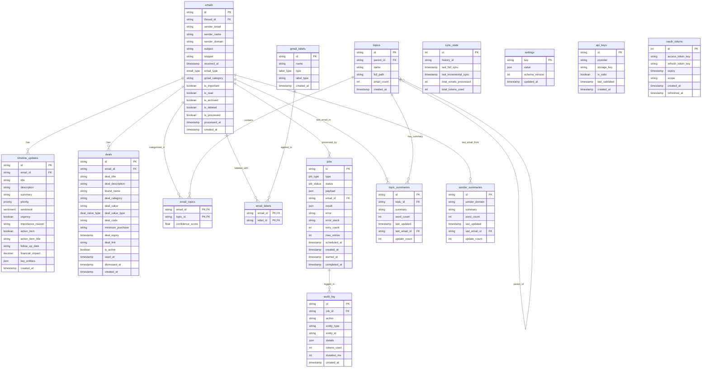

# TuskerBrain Database Architecture

**Generated**: March 24, 2026  
**Database Type**: SQLite (better-sqlite3)  
**ORM**: Drizzle ORM  
**Location**: `~/Library/Application Support/TuskerBrain/tuskerbrain.db`

---

## 📊 Database Overview

| Property | Value |
|----------|-------|
| **Total Tables** | 16 |
| **Total Indexes** | 14 |
| **Foreign Keys** | 11 |
| **Primary Entity** | `emails` |

---

## 📋 Complete Table Inventory

### 1. Core Email Tables

#### `emails` — Primary Email Storage

The central table storing all Gmail message data.

| Column | Type | Constraints | Description |
|--------|------|-------------|-------------|
| `id` | TEXT | PRIMARY KEY | Gmail email ID |
| `threadId` | TEXT | NOT NULL | Gmail thread ID |
| `senderEmail` | TEXT | NOT NULL | Sender's email address |
| `senderName` | TEXT | | Sender's display name |
| `senderDomain` | TEXT | NOT NULL | Extracted domain (e.g., `amazon.com`) |
| `subject` | TEXT | | Email subject line |
| `snippet` | TEXT | | Email preview/snippet |
| `receivedAt` | INTEGER | NOT NULL, TIMESTAMP | When email was received |
| `emailType` | TEXT | ENUM | `regular`, `updates`, `social`, `promotional` |
| `gmailCategory` | TEXT | | Gmail's native category |
| `isImportant` | BOOLEAN | DEFAULT false | Marked as important |
| `isRead` | BOOLEAN | DEFAULT false | Read status |
| `isArchived` | BOOLEAN | DEFAULT false | Archived status |
| `isDeleted` | BOOLEAN | DEFAULT false | Deleted status |
| `isProcessed` | BOOLEAN | DEFAULT false | AI processed flag |
| `processedAt` | INTEGER | TIMESTAMP | When processing completed |
| `createdAt` | INTEGER | TIMESTAMP | Record creation time |

**Indexes**:
- `idx_emails_received_at` ON `emails(received_at DESC)`
- `idx_emails_sender_domain` ON `emails(sender_domain)`
- `idx_emails_email_type` ON `emails(email_type)`
- `idx_emails_is_processed` ON `emails(is_processed)`

---

#### `timeline_updates` — AI-Extracted Actionable Items

Stores processed email content transformed into actionable updates.

| Column | Type | Constraints | Description |
|--------|------|-------------|-------------|
| `id` | TEXT | PRIMARY KEY | Unique update ID |
| `emailId` | TEXT | FK → `emails.id` (CASCADE) | Source email reference |
| `title` | TEXT | NOT NULL | Update title |
| `description` | TEXT | | Detailed description |
| `summary` | TEXT | | Concise summary |
| `priority` | TEXT | ENUM | `high`, `medium`, `low` |
| `sentiment` | TEXT | ENUM | `positive`, `negative`, `neutral` |
| `urgency` | BOOLEAN | DEFAULT false | Time-sensitive flag |
| `importanceReason` | TEXT | | Why it's important |
| `actionItem` | BOOLEAN | DEFAULT false | Has action item |
| `actionItemTitle` | TEXT | | Action item title |
| `followUpDate` | TEXT | | Due date string |
| `financialImpact` | REAL | | Monetary value |
| `keyEntities` | JSON | | `{dates: string[], amounts: number[], names: string[]}` |
| `createdAt` | INTEGER | TIMESTAMP | Creation time |

**Indexes**:
- `idx_timeline_updates_priority` ON `timeline_updates(priority)`

**Foreign Keys**:
- `emailId` → `emails.id` (ON DELETE CASCADE)

---

#### `deals` — Extracted Promotional Offers

Stores deal/discount information extracted from promotional emails.

| Column | Type | Constraints | Description |
|--------|------|-------------|-------------|
| `id` | TEXT | PRIMARY KEY | Unique deal ID |
| `emailId` | TEXT | FK → `emails.id` (CASCADE) | Source email reference |
| `dealTitle` | TEXT | NOT NULL | Deal title |
| `dealDescription` | TEXT | | Deal description |
| `brandName` | TEXT | NOT NULL | Brand/company name |
| `dealCategory` | TEXT | | Category (electronics, clothing, etc.) |
| `dealValue` | TEXT | | Discount value |
| `dealValueType` | TEXT | ENUM | `percentage`, `fixed_amount`, `other` |
| `dealCode` | TEXT | | Promo/discount code |
| `minimumPurchase` | TEXT | | Minimum spend required |
| `dealExpiry` | INTEGER | TIMESTAMP | Offer expiry date |
| `dealLink` | TEXT | | Direct link to offer |
| `isActive` | BOOLEAN | DEFAULT true | Still active |
| `usedAt` | INTEGER | TIMESTAMP | When marked as used |
| `dismissedAt` | INTEGER | TIMESTAMP | When dismissed |
| `createdAt` | INTEGER | TIMESTAMP | Creation time |

**Indexes**:
- `idx_deals_deal_expiry` ON `deals(deal_expiry)`
- `idx_deals_active_expiry` ON `deals(is_active, deal_expiry)`
- `idx_deals_category` ON `deals(deal_category)`
- `idx_deals_brand` ON `deals(brand_name)`

**Foreign Keys**:
- `emailId` → `emails.id` (ON DELETE CASCADE)

---

### 2. Topic & Organization Tables

#### `topics` — Hierarchical Topic Structure

Stores the hierarchical topic/category system for email organization.

| Column | Type | Constraints | Description |
|--------|------|-------------|-------------|
| `id` | TEXT | PRIMARY KEY | Topic ID |
| `parentId` | TEXT | | Parent topic ID (self-referencing) |
| `name` | TEXT | NOT NULL | Topic name |
| `fullPath` | TEXT | NOT NULL, UNIQUE | Full path (e.g., `"Banking/Chase"`) |
| `emailCount` | INTEGER | DEFAULT 0 | Number of emails in topic |
| `createdAt` | INTEGER | TIMESTAMP | Creation time |

**Hierarchy Example**:
```
Banking (topic-banking, parentId: null)
├── Chase (topic-chase, parentId: topic-banking)
├── HSBC (topic-hsbc, parentId: topic-banking)
└── AWS (topic-aws, parentId: topic-banking)

Shopping (topic-shopping, parentId: null)
├── Amazon (topic-amazon, parentId: topic-shopping)
└── Target (topic-target, parentId: topic-shopping)
```

**Predefined Parent Categories**:
- Banking, Education, Projects, Shopping, Travel, Health, Personal, Business, Technology, Entertainment

---

#### `email_topics` — Junction Table (Emails ↔ Topics)

Many-to-many relationship between emails and topics.

| Column | Type | Constraints | Description |
|--------|------|-------------|-------------|
| `emailId` | TEXT | FK → `emails.id` (CASCADE) | Email reference |
| `topicId` | TEXT | FK → `topics.id` (CASCADE) | Topic reference |
| `confidenceScore` | REAL | | AI confidence score (0-1) |

**Primary Key**: `(emailId, topicId)` composite

**Indexes**:
- `idx_email_topics_topic_id` ON `email_topics(topic_id)`

**Foreign Keys**:
- `emailId` → `emails.id` (ON DELETE CASCADE)
- `topicId` → `topics.id` (ON DELETE CASCADE)

---

#### `topic_summaries` — Rolling Topic Summaries

AI-generated rolling summaries for each topic.

| Column | Type | Constraints | Description |
|--------|------|-------------|-------------|
| `id` | TEXT | PRIMARY KEY | Summary ID |
| `topicId` | TEXT | FK → `topics.id` (CASCADE), UNIQUE | Topic reference |
| `summary` | TEXT | NOT NULL | 3-4 paragraph summary (max 500 words) |
| `wordCount` | INTEGER | | Word count |
| `lastUpdated` | INTEGER | TIMESTAMP | Last update time |
| `lastEmailId` | TEXT | FK → `emails.id` | Most recent email |
| `updateCount` | INTEGER | DEFAULT 0 | Number of updates |

**Foreign Keys**:
- `topicId` → `topics.id` (ON DELETE CASCADE)
- `lastEmailId` → `emails.id`

---

#### `sender_summaries` — Per-Sender Domain Summaries

AI-generated summaries for each unique sender domain.

| Column | Type | Constraints | Description |
|--------|------|-------------|-------------|
| `id` | TEXT | PRIMARY KEY | Summary ID |
| `senderDomain` | TEXT | NOT NULL, UNIQUE | Domain (e.g., `amazon.com`) |
| `summary` | TEXT | NOT NULL | Sender summary |
| `wordCount` | INTEGER | | Word count |
| `lastUpdated` | INTEGER | TIMESTAMP | Last update time |
| `lastEmailId` | TEXT | FK → `emails.id` | Most recent email |
| `updateCount` | INTEGER | DEFAULT 0 | Number of updates |

**Foreign Keys**:
- `lastEmailId` → `emails.id`

---

### 3. Gmail Label Tables

#### `gmail_labels` — Gmail Label Definitions

Stores Gmail label/folder definitions created by TuskerBrain.

| Column | Type | Constraints | Description |
|--------|------|-------------|-------------|
| `id` | TEXT | PRIMARY KEY | Label ID |
| `name` | TEXT | NOT NULL, UNIQUE | Label name |
| `type` | TEXT | ENUM | `system`, `user` |
| `labelType` | TEXT | | Label type metadata |
| `createdAt` | INTEGER | TIMESTAMP | Creation time |

**Label Hierarchy**:
```
TuskerBrain/
├── Processed
├── Topic/
│   ├── Banking/
│   │   ├── Chase
│   │   └── HSBC
│   └── Shopping/
│       └── Amazon
└── Sender/
    └── chase.com
```

---

#### `email_labels` — Junction Table (Emails ↔ Labels)

Many-to-many relationship between emails and Gmail labels.

| Column | Type | Constraints | Description |
|--------|------|-------------|-------------|
| `emailId` | TEXT | FK → `emails.id` (CASCADE) | Email reference |
| `labelId` | TEXT | FK → `gmail_labels.id` (CASCADE) | Label reference |

**Primary Key**: `(emailId, labelId)` composite

**Foreign Keys**:
- `emailId` → `emails.id` (ON DELETE CASCADE)
- `labelId` → `gmail_labels.id` (ON DELETE CASCADE)

---

### 4. Job System Tables

#### `jobs` — Background Job Queue

Stores background jobs for async processing.

| Column | Type | Constraints | Description |
|--------|------|-------------|-------------|
| `id` | TEXT | PRIMARY KEY | Job ID |
| `type` | TEXT | NOT NULL, ENUM | Job type |
| `status` | TEXT | NOT NULL, DEFAULT 'pending' | Current status |
| `payload` | JSON | NOT NULL | Job parameters |
| `emailId` | TEXT | FK → `emails.id` (CASCADE) | Related email |
| `result` | JSON | | Job result data |
| `error` | TEXT | | Error message |
| `errorStack` | TEXT | | Stack trace |
| `retryCount` | INTEGER | DEFAULT 0 | Retry attempts |
| `maxRetries` | INTEGER | DEFAULT 3 | Max retry limit |
| `scheduledAt` | INTEGER | TIMESTAMP | Scheduled execution time |
| `createdAt` | INTEGER | TIMESTAMP | Creation time |
| `startedAt` | INTEGER | TIMESTAMP | When started |
| `completedAt` | INTEGER | TIMESTAMP | When completed |

**Job Types**:
- `email_process` — Process email with AI
- `email_archive` — Archive old email
- `email_delete` — Delete email
- `topic_summary_update` — Update topic summary
- `sender_summary_update` — Update sender summary
- `backfill_day` — Backfill processing for a day

**Job Status Values**:
- `pending` — Waiting to be processed
- `running` — Currently executing
- `completed` — Successfully finished
- `failed` — Encountered error
- `retrying` — Being retried
- `dead` — Exceeded max retries

**Indexes**:
- `idx_jobs_status` ON `jobs(status)`
- `idx_jobs_scheduled_at` ON `jobs(scheduled_at)`

**Foreign Keys**:
- `emailId` → `emails.id` (ON DELETE CASCADE)

---

#### `audit_log` — Operation Audit Trail

Tracks all AI operations and token usage.

| Column | Type | Constraints | Description |
|--------|------|-------------|-------------|
| `id` | TEXT | PRIMARY KEY | Log entry ID |
| `jobId` | TEXT | FK → `jobs.id` (SET NULL) | Related job |
| `action` | TEXT | NOT NULL | Action performed |
| `entityType` | TEXT | | Entity type (email, topic, etc.) |
| `entityId` | TEXT | | Entity ID |
| `details` | JSON | | Additional details |
| `tokensUsed` | INTEGER | | LLM tokens consumed |
| `durationMs` | INTEGER | | Operation duration in milliseconds |
| `createdAt` | INTEGER | TIMESTAMP | Creation time |

**Indexes**:
- `idx_audit_log_created_at` ON `audit_log(created_at DESC)`

**Foreign Keys**:
- `jobId` → `jobs.id` (ON DELETE SET NULL)

---

### 5. Sync & Configuration Tables

#### `sync_state` — Gmail Sync Tracking

Tracks Gmail synchronization state (single-row table).

| Column | Type | Constraints | Description |
|--------|------|-------------|-------------|
| `id` | INTEGER | PRIMARY KEY, DEFAULT 1 | Single row constraint |
| `historyId` | TEXT | | Gmail history ID |
| `lastFullSync` | INTEGER | TIMESTAMP | Last full sync time |
| `lastIncrementalSync` | INTEGER | TIMESTAMP | Last incremental sync |
| `totalEmailsProcessed` | INTEGER | DEFAULT 0 | Total processed count |
| `totalTokensUsed` | INTEGER | DEFAULT 0 | Total LLM tokens used |

**Note**: This table maintains exactly one row with `id = 1`.

---

#### `settings` — Application Settings (Key-Value)

Stores application configuration as key-value pairs.

| Column | Type | Constraints | Description |
|--------|------|-------------|-------------|
| `key` | TEXT | PRIMARY KEY | Setting key |
| `value` | JSON | NOT NULL | Setting value |
| `schemaVersion` | INTEGER | DEFAULT 1 | Schema version |
| `updatedAt` | INTEGER | TIMESTAMP | Last update time |

**Example Keys**:
- `lookbackPeriod` — Days to sync (7-90)
- `syncInterval` — Incremental sync frequency
- `llmProvider` — Selected LLM provider
- `onboardingComplete` — Boolean flag

---

#### `api_keys` — LLM Provider API Keys

Stores encrypted LLM provider API keys.

| Column | Type | Constraints | Description |
|--------|------|-------------|-------------|
| `id` | TEXT | PRIMARY KEY | Key ID |
| `provider` | TEXT | NOT NULL, UNIQUE | Provider name |
| `storageKey` | TEXT | NOT NULL | Encrypted storage key reference |
| `isValid` | BOOLEAN | DEFAULT false | Validation status |
| `lastValidated` | INTEGER | TIMESTAMP | Last validation time |
| `createdAt` | INTEGER | TIMESTAMP | Creation time |

**Providers**:
- `openai`
- `anthropic`
- `google`

---

#### `oauth_tokens` — Gmail OAuth Tokens

Stores encrypted Gmail OAuth tokens (single-row table).

| Column | Type | Constraints | Description |
|--------|------|-------------|-------------|
| `id` | INTEGER | PRIMARY KEY, DEFAULT 1, CHECK(id=1) | Single row constraint |
| `accessTokenKey` | TEXT | NOT NULL | Encrypted access token reference |
| `refreshTokenKey` | TEXT | NOT NULL | Encrypted refresh token reference |
| `expiry` | INTEGER | TIMESTAMP | Token expiry time |
| `scope` | TEXT | | OAuth scopes |
| `createdAt` | INTEGER | TIMESTAMP | Creation time |
| `refreshedAt` | INTEGER | TIMESTAMP | Last refresh time |

**Note**: This table maintains exactly one row with `id = 1`.

---

## 🔗 Entity Relationship Diagram



---

## 🔑 Foreign Key Relationships Summary

| From Table | Column | To Table | On Delete | On Update |
|------------|--------|----------|-----------|-----------|
| `timeline_updates` | `emailId` | `emails.id` | CASCADE | — |
| `deals` | `emailId` | `emails.id` | CASCADE | — |
| `email_topics` | `emailId` | `emails.id` | CASCADE | — |
| `email_topics` | `topicId` | `topics.id` | CASCADE | — |
| `topic_summaries` | `topicId` | `topics.id` | CASCADE | — |
| `topic_summaries` | `lastEmailId` | `emails.id` | — | — |
| `sender_summaries` | `lastEmailId` | `emails.id` | — | — |
| `email_labels` | `emailId` | `emails.id` | CASCADE | — |
| `email_labels` | `labelId` | `gmail_labels.id` | CASCADE | — |
| `jobs` | `emailId` | `emails.id` | CASCADE | — |
| `audit_log` | `jobId` | `jobs.id` | SET NULL | — |

---

## 📈 Data Flow Architecture

### Email Processing Pipeline

```
┌─────────────────────────────────────────────────────────────────────────────┐
│                         EMAIL PROCESSING FLOW                                │
└─────────────────────────────────────────────────────────────────────────────┘

1. Gmail API Sync
   │
   ├─► Fetch emails from Gmail API
   │
   └─► INSERT INTO emails (raw email data)
       └─► emails table

2. Job Queue Creation
   │
   ├─► Create processing job
   │
   └─► INSERT INTO jobs (type: 'email_process', payload: {emailId})
       └─► jobs table (status: 'pending')

3. Job Execution (JobRunner)
   │
   ├─► Poll for pending jobs
   ├─► UPDATE jobs SET status = 'running', startedAt = NOW()
   │
   └─► Execute job

4. AI Processing (LangGraph Workflow)
   │
   ├─► Step 1: Classify
   │   └─► UPDATE emails SET emailType = 'regular' | 'updates' | 'social' | 'promotional'
   │
   ├─► Step 2: Decide
   │   └─► Determine action: process | archive | delete | extract
   │
   ├─► Step 3: Extract
   │   ├─► INSERT INTO timeline_updates (actionable items)
   │   ├─► INSERT INTO deals (if promotional)
   │   └─► Extract key entities, financial impact, action items
   │
   ├─► Step 4: Label
   │   ├─► INSERT/UPDATE topics (hierarchical structure)
   │   ├─► INSERT INTO email_topics (email ↔ topic mapping)
   │   ├─► INSERT INTO gmail_labels (Gmail label creation)
   │   └─► INSERT INTO email_labels (email ↔ label mapping)
   │
   └─► Step 5: Summarize
       ├─► INSERT/UPDATE topic_summaries (rolling topic summary)
       └─► INSERT/UPDATE sender_summaries (rolling sender summary)

5. Audit Logging
   │
   └─► INSERT INTO audit_log
       ├─► action: 'email_processed'
       ├─► entityType: 'email'
       ├─► entityId: <email_id>
       ├─► tokensUsed: <count>
       └─► durationMs: <milliseconds>

6. Job Completion
   │
   ├─► UPDATE jobs SET
   │   ├─► status = 'completed'
   │   ├─► completedAt = NOW()
   │   └─► result = {success: true}
   │
   └─► UPDATE emails SET
       ├─► isProcessed = true
       └─► processedAt = NOW()

7. Gmail Label Sync (Bidirectional)
   │
   └─► Apply labels to email in Gmail via API
       └─► Labels visible in both TuskerBrain and Gmail
```

### Incremental Sync Flow

```
┌─────────────────────────────────────────────────────────────────────────────┐
│                        INCREMENTAL SYNC FLOW                                 │
└─────────────────────────────────────────────────────────────────────────────┘

1. Read Sync State
   │
   └─► SELECT lastIncrementalSync, historyId FROM sync_state WHERE id = 1

2. Fetch Changed Emails
   │
   └─► Gmail API: users.messages.list with historyId
       └─► Returns new/modified emails since last sync

3. Insert New Emails
   │
   └─► INSERT INTO emails (new email records)

4. Create Processing Jobs
   │
   └─► INSERT INTO jobs (type: 'email_process') for each new email

5. Update Sync State
   │
   └─► UPDATE sync_state SET
       ├─► lastIncrementalSync = NOW()
       ├─► historyId = <new_history_id>
       └─► totalEmailsProcessed = totalEmailsProcessed + <count>

6. Schedule Summary Updates
   │
   └─► INSERT INTO jobs (type: 'topic_summary_update' | 'sender_summary_update')
```

### Initial Backfill Flow

```
┌─────────────────────────────────────────────────────────────────────────────┐
│                         INITIAL BACKFILL FLOW                                │
└─────────────────────────────────────────────────────────────────────────────┘

1. User Configuration
   │
   └─► SELECT value FROM settings WHERE key = 'lookbackPeriod'
       └─► e.g., 30 days

2. Phase 1: Clean First (No AI)
   │
   ├─► Fetch all emails in lookback period
   │
   ├─► Apply archival/deletion rules based on email age and type
   │   ├─► Social/Promotional > 1 month → DELETE
   │   ├─► Updates > 6 months → ARCHIVE
   │   └─► Regular > 2 years → ARCHIVE
   │
   └─► Fast operation, no API costs

3. Phase 2: AI Processing (Gradual Backfill)
   │
   ├─► Process one day at a time
   │
   ├─► For each day in lookback period:
   │   ├─► INSERT INTO jobs (type: 'backfill_day', payload: {date})
   │   ├─► JobRunner processes jobs
   │   └─► Real-time progress: "Processing day 15 of 30..."
   │
   └─► Can be paused/resumed
```

---

## 🎯 Key Design Patterns

### 1. Soft Deletes

Instead of hard deleting records, use boolean/timestamp flags:

```sql
-- Emails
isDeleted BOOLEAN DEFAULT false
isArchived BOOLEAN DEFAULT false

-- Deals
dismissedAt TIMESTAMP
usedAt TIMESTAMP

-- Usage Example
UPDATE emails SET isDeleted = true WHERE id = 'email-123';
UPDATE deals SET dismissedAt = NOW() WHERE id = 'deal-456';
```

### 2. Cascade Deletes

Child records automatically deleted when parent email is deleted:

```sql
-- All these cascade when emails.id is deleted
timeline_updates.emailId → emails.id (CASCADE)
deals.emailId → emails.id (CASCADE)
email_topics.emailId → emails.id (CASCADE)
email_labels.emailId → emails.id (CASCADE)
jobs.emailId → emails.id (CASCADE)
```

### 3. Single-Row Tables

Tables that maintain exactly one row using CHECK constraints:

```sql
-- sync_state
CREATE TABLE sync_state (
  id INTEGER PRIMARY KEY DEFAULT 1,
  -- Only one row with id=1
);

-- oauth_tokens
CREATE TABLE oauth_tokens (
  id INTEGER PRIMARY KEY CHECK(id = 1),
  -- Enforces id must be 1
);
```

### 4. JSON Columns

Flexible storage for complex/nested data:

```sql
-- jobs.payload: Job parameters
{ "emailId": "email-123", "force": true }

-- jobs.result: Job output
{ "success": true, "timelineUpdates": 3, "deals": 1 }

-- timeline_updates.keyEntities: Extracted entities
{
  "dates": ["2026-04-01", "2026-04-15"],
  "amounts": [247.12, 1245.00],
  "names": ["AWS", "Chase"]
}

-- audit_log.details: Additional context
{ "provider": "anthropic", "model": "claude-3-sonnet" }
```

### 5. Timestamp Tracking

Comprehensive timestamp tracking for auditability:

```sql
-- All tables have createdAt
createdAt INTEGER TIMESTAMP

-- Jobs have lifecycle timestamps
createdAt  → Job created
startedAt  → Job started
completedAt → Job finished

-- Updates have modification tracking
lastUpdated → Last modification time
```

### 6. Job Retry Logic

Automatic retry with exponential backoff:

```sql
-- Track retry state
retryCount INTEGER DEFAULT 0
maxRetries INTEGER DEFAULT 3
scheduledAt TIMESTAMP

-- Retry flow
UPDATE jobs SET
  retryCount = retryCount + 1,
  status = 'retrying',
  scheduledAt = NOW() + (2 ^ retryCount) * 5 minutes
WHERE status = 'failed';
```

### 7. Audit Trail

Complete traceability of all AI operations:

```sql
-- Every LLM call is logged
INSERT INTO audit_log (
  jobId,
  action,           -- 'classify_email', 'extract_deals', 'summarize_topic'
  entityType,       -- 'email', 'topic', 'sender'
  entityId,         -- ID of affected entity
  details,          -- { provider, model, prompt_tokens, completion_tokens }
  tokensUsed,       -- Total tokens consumed
  durationMs,       -- API call duration
  createdAt
);

-- Aggregate token usage
SELECT SUM(tokensUsed) FROM audit_log;
-- vs stored counter
SELECT totalTokensUsed FROM sync_state;
```

---

## 📊 Database Statistics & Queries

### Common Analytics Queries

```sql
-- Total emails and processing status
SELECT
  COUNT(*) as total_emails,
  SUM(CASE WHEN isProcessed THEN 1 ELSE 0 END) as processed,
  SUM(CASE WHEN NOT isProcessed THEN 1 ELSE 0 END) as pending
FROM emails;

-- Emails by type
SELECT emailType, COUNT(*) as count
FROM emails
GROUP BY emailType;

-- Active deals count
SELECT COUNT(*) as active_deals
FROM deals
WHERE isActive = true
  AND dismissedAt IS NULL
  AND (dealExpiry IS NULL OR dealExpiry > NOW());

-- Deals expiring soon (within 7 days)
SELECT dealTitle, brandName, dealExpiry
FROM deals
WHERE isActive = true
  AND dealExpiry BETWEEN NOW() AND NOW() + INTERVAL '7 days';

-- Topic coverage
SELECT
  t.fullPath,
  t.emailCount,
  ts.wordCount,
  ts.updateCount
FROM topics t
LEFT JOIN topic_summaries ts ON t.id = ts.topicId
ORDER BY t.emailCount DESC;

-- Top senders by email count
SELECT
  senderDomain,
  COUNT(*) as emailCount
FROM emails
GROUP BY senderDomain
ORDER BY emailCount DESC
LIMIT 10;

-- Job queue health
SELECT
  status,
  COUNT(*) as count
FROM jobs
GROUP BY status;

-- Failed jobs requiring attention
SELECT id, type, error, retryCount
FROM jobs
WHERE status IN ('failed', 'dead')
ORDER BY createdAt DESC;

-- Token usage by day
SELECT
  DATE(createdAt) as date,
  SUM(tokensUsed) as total_tokens,
  COUNT(*) as operations
FROM audit_log
GROUP BY DATE(createdAt)
ORDER BY date DESC
LIMIT 30;

-- Average processing time per job type
SELECT
  j.type,
  AVG(a.durationMs) as avg_duration_ms,
  AVG(a.tokensUsed) as avg_tokens
FROM jobs j
JOIN audit_log a ON j.id = a.jobId
GROUP BY j.type;
```

---

## 🔐 Security Considerations

### Sensitive Data Storage

| Table | Sensitive Column | Storage Method |
|-------|------------------|----------------|
| `api_keys` | `storageKey` | Electron safeStorage API (encrypted) |
| `oauth_tokens` | `accessTokenKey`, `refreshTokenKey` | Electron safeStorage API (encrypted) |

### Access Patterns

- All database operations go through the `TuskerBrainDatabase` class
- Drizzle ORM provides type-safe queries
- No direct SQL injection risks (parameterized queries)
- Context isolation in Electron prevents renderer direct access

---

## 📦 Schema Files Reference

| File | Purpose |
|------|---------|
| `database/schema.ts` | Drizzle ORM schema definitions |
| `database/types.ts` | TypeScript type exports |
| `database/index.ts` | Database class and initialization |
| `database/deals.ts` | Deal-specific utilities and types |
| `database/seeder.ts` | Sample data seeder |

---

## 🚀 Migration Management

### Generate Migrations

```bash
pnpm run db:generate
```

### Apply Migrations

```bash
pnpm run db:push
```

### Migration Location

Migrations are stored in: `database/migrations/`

---

## 📝 Version History

| Version | Date | Changes |
|---------|------|---------|
| 1.0 | March 2026 | Initial schema with 16 tables |

---

**Document Generated**: March 24, 2026  
**TuskerBrain Version**: 1.0.0
